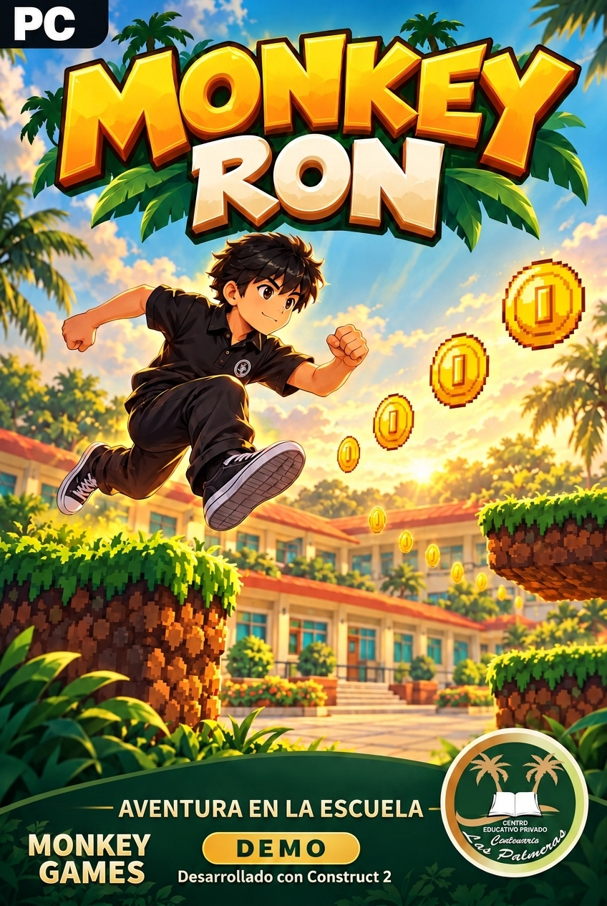
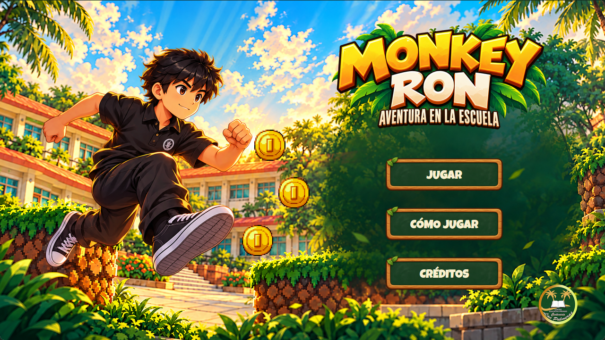
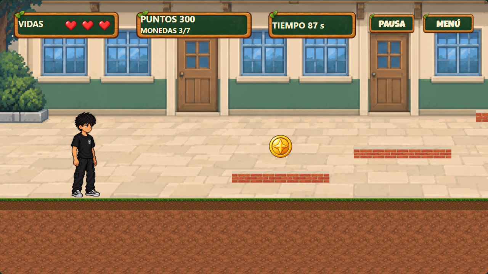
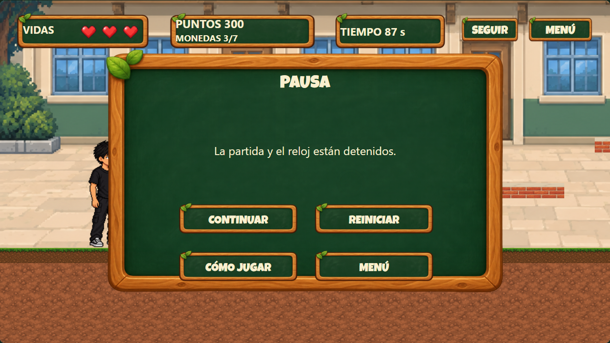
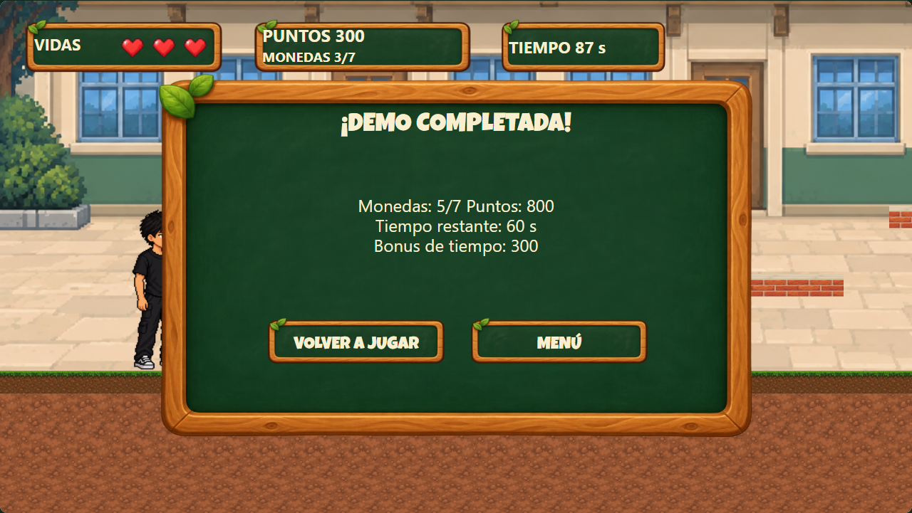

# 🐵 Monkey Ron — Aventura en la Escuela (Monkey Games)

<p align="center">
  
</p>

<p align="center">
  <a href="https://github.com/hfreedo/Monkey-Ron/releases/latest/download/Monkey_Ron_demo_v5.capx">
    
  </a>
  <a href="https://github.com/hfreedo/Monkey-Ron/releases/latest/download/Monkey_Ron_actual.zip">
    
  </a>
</p>

---

## 👋 ¡Bienvenidos al repositorio oficial de Monkey Ron!

Este repositorio contiene el proyecto actualizado de **Monkey Ron** (desarrollado en **Construct 2** por el equipo **Monkey Games** / Team Axel), junto con todos sus recursos gráficos, sonidos, vistas previas de pantallas y los **materiales listos para imprimir para la feria/exposición escolar (portanombres, stickers de colección completa v2, manuales de juego v3, credenciales y portadas retail)**.

---

## 📥 1. ¿Cómo descargar el juego? (Guía para alumnos)

Tienes **tres formas sencillas** de descargar los archivos según lo que necesites hacer:

1. **Solo quiero abrir el juego actualizado en Construct 2 (Recomendado):**
   - Haz clic en el botón verde superior **🎮 Descargar Proyecto Construct 2 (`Monkey_Ron_demo_v5.capx`)** o entra en [`Proyecto/Monkey_Ron_demo_v5.capx`](Proyecto/Monkey_Ron_demo_v5.capx) y pulsa **Download raw file**.
2. **Quiero el paquete completo de la entrega (`.zip` con proyecto + imágenes + vistas):**
   - Haz clic en el botón azul **📦 Descargar Paquete Completo (`Monkey_Ron_actual.zip`)** o visita la sección [**Releases (Lanzamientos)**](https://github.com/hfreedo/Monkey-Ron/releases).
3. **Quiero descargar todo el repositorio (incluyendo manuales v3, stickers coleccionables, portanombres y versiones originales):**
   - Arriba a la derecha en esta página de GitHub, haz clic en el botón verde **`<> Code`** y selecciona **`Download ZIP`**. Extrae el archivo `.zip` en tu computadora.

> [!IMPORTANT]
> **Consejo antes de editar en Construct 2:** Cuando abras `Monkey_Ron_demo_v5.capx`, guarda primero una copia con otro nombre (por ejemplo, `Monkey_Ron_demo_v5_prueba.capx`) para conservar siempre intacta la versión base.

---

## 🖼️ 2. Vista previa de las pantallas (Demo v5)

| Menú Principal | Partida y HUD |
|:---:|:---:|
|  |  |

| Menú de Pausa | Pantalla de Victoria |
|:---:|:---:|
|  |  |

💡 *Puedes inspeccionar las 12 pantallas interactivas abriendo el archivo [`Proyecto/Vista/Vista_demo.html`](Proyecto/Vista/Vista_demo.html) en tu navegador luego de descargar el repositorio.*

---

## 🎮 3. Controles y Reglas de la Demo v5

### Controles
- **Flechas Izquierda / Derecha (`←` / `→`):** Mover a Ron por el patio escolar.
- **Flecha Arriba (`↑`):** Saltar obstáculos y subir a las plataformas.
- **Tecla `ESC` o botón `PAUSA`:** Pausar la partida, consultar las instrucciones (`CÓMO JUGAR`), reiniciar o volver al menú.

### Reglas del juego implementadas
- **Vidas:** Comienzas con **3 corazones**. Tocar el charco con conos resta 1 corazón, te devuelve al último punto seguro y te da **1,5 segundos de invulnerabilidad** con parpadeo.
- **Tiempo:** Tienes **120 segundos** para llegar a la meta. El reloj se detiene automáticamente cuando abres la Pausa o la Ayuda.
- **Monedas y Puntuación:** Hay **7 monedas doradas** en el recorrido (**100 puntos** cada una). No es obligatorio juntarlas todas para ganar, ¡pero suman para tu récord!
- **Punto de Control (Checkpoint):** Al cruzar el tramo entre `X = 3000` y `X = 3400`, se guarda tu progreso para reaparecer en `X = 3104, Y = 896`.
- **Meta y Bonus de Victoria:** Al llegar a la **bandera META** (`X = 5632`) con vida y tiempo restantes, ganas la partida y recibes un **bonus de +5 puntos por cada segundo restante**.

---

## 🛠️ 4. ¿Qué incluye la versión `v5` y cómo funciona por dentro?

Si vas a revisar o modificar el proyecto en **Construct 2**, ten en cuenta cómo está armado:

| Sistema | Cómo está implementado en `Monkey_Ron_demo_v5.capx` |
|---|---|
| **Física vs. Dibujo del Personaje** | El objeto original `aaron` maneja la física y las colisiones (permanece invisible para que cambiar de pose no trabe al personaje). El sprite `RonVisual` sigue a `aaron` y muestra las poses (`quieto`, `correr`, `saltar`). |
| **Escenario y Cámara** | La capa de juego tiene `Parallax 1,1` para acompañar el movimiento, mientras que el HUD y los paneles tienen `Parallax 0,0` para quedarse fijos en pantalla. |
| **Audio corregido** | Los 6 efectos de sonido (`salto`, `aterrizaje`, `moneda`, `daño`, `victoria`, `derrota`) están registrados en `sounds-folder` en formatos WAV, OGG y M4A listos para Construct 2. |
| **Tipografía** | Los botones usan la fuente temática **Luckiest Guy** sobre pizarra vacía (`boton_pizarra_vacio.png`), permitiendo editar los textos directamente en Construct 2. |

---

## 🖨️ 5. Materiales Imprimibles para la Exposición (`Imprimibles_Monkey_Games/`)

Todos los materiales gráficos del stand de **Monkey Games** están listos en formato **PDF A4** (para imprimir al 100 % sin escalar) y cuentan con archivos editables `.svg`:

| Material | Archivo PDF listo para imprimir (A4) | Vista previa / Instrucciones |
|---|---|---|
| **1. Portanombre de Mesa (v4)** | [`Portanombre_Monkey_Ron_Monkey_Games_A4_v4.pdf`](Imprimibles_Monkey_Games/01_Portanombres/Imprimir/Portanombre_Monkey_Ron_Monkey_Games_A4_v4.pdf) | Plegable doble cara con espacio para el nombre del alumno. [Ver vista previa](Imprimibles_Monkey_Games/01_Portanombres/Vista_previa/Cara_Monkey_Ron.png) |
| **2. Colección Completa de Stickers (v2)** | [`Stickers_Monkey_Games_Coleccion_completa_A4_v2.pdf`](Imprimibles_Monkey_Games/02_Stickers/Imprimir/Stickers_Monkey_Games_Coleccion_completa_A4_v2.pdf) · [Plancha v1](Imprimibles_Monkey_Games/02_Stickers/Imprimir/Plancha_Stickers_Monkey_Games_A4_v1.pdf) | **6 motivos nuevos:** Insignia, Moneda, Ron, Ron con Bandera, Pulgar Arriba y Señalando (2 hojas A4). [Leer guía](Imprimibles_Monkey_Games/02_Stickers/LEEME.md) |
| **3. Manual de Juego (v3)** | [`Manual_Monkey_Ron_Cuadernillo_A4_v3.pdf`](Imprimibles_Monkey_Games/03_Manual_de_Juego/Imprimir/Manual_Monkey_Ron_Cuadernillo_A4_v3.pdf) · [Versión Digital v3](Imprimibles_Monkey_Games/03_Manual_de_Juego/Digital/Manual_Monkey_Ron_12x18_v3.pdf) | Cuadernillo de 4 páginas (12 × 18 cm) con avatares ilustrados, controles, objetivo y consejos. [Leer guía de plegado](Imprimibles_Monkey_Games/03_Manual_de_Juego/LEEME.md) |
| **4. Credenciales del Equipo (v1)** | [`Credencial_Monkey_Games_90x120_v1_A4.pdf`](Imprimibles_Monkey_Games/04_Credenciales/Imprimir/Credencial_Monkey_Games_90x120_v1_A4.pdf) | 4 credenciales de 9 × 12 cm por hoja A4 con nombre y rol para completar. [Leer guía](Imprimibles_Monkey_Games/04_Credenciales/LEEME.md) |
| **5. Portada Retail y Cuadro (v2)** | [`Portada_Monkey_Ron_Monkey_Games_12x18_A4_v2.pdf`](Imprimibles_Monkey_Games/05_Portada_Imprimible/Imprimir/Portada_Monkey_Ron_Monkey_Games_12x18_A4_v2.pdf) · [Portada Digital v2](Portadas/Portada_Monkey_Ron_Retail_PC_Demo_v2.png) | Carátula retail para caja o exhibidor de 12 × 18 cm. [Leer guía](Imprimibles_Monkey_Games/05_Portada_Imprimible/LEEME.md) |

---

## 📚 Documentación del equipo en Office

Los tres documentos editables están en [`Documentacion/`](Documentacion/):

| Archivo | Contenido | Descarga directa |
|---|---|---|
| [GDD Monkey Ron.docx](Documentacion/GDD%20Monkey%20Ron.docx) | Nueve páginas ilustradas con reglas, organización, responsabilidades, bitácora y pruebas pendientes. | [Descargar Word](https://github.com/hfreedo/Monkey-Ron/raw/refs/heads/main/Documentacion/GDD%20Monkey%20Ron.docx) |
| [Inventario Monkey Ron.xlsx](Documentacion/Inventario%20Monkey%20Ron.xlsx) | 43 recursos agrupados, 76 miniaturas y seis efectos de sonido originales incrustados. | [Descargar Excel](https://github.com/hfreedo/Monkey-Ron/raw/refs/heads/main/Documentacion/Inventario%20Monkey%20Ron.xlsx) |
| [Guía Monkey Ron.pptx](Documentacion/Gu%C3%ADa%20Monkey%20Ron.pptx) | Diez diapositivas con controles, consejos y enlaces para recorrer la guía. | [Descargar PowerPoint](https://github.com/hfreedo/Monkey-Ron/raw/refs/heads/main/Documentacion/Gu%C3%ADa%20Monkey%20Ron.pptx) |

Para escuchar los audios, descargar el inventario, abrirlo en Excel de escritorio para Windows y hacer doble clic en el icono. La reproducción usa el programa asociado a M4A del equipo. Para usar los enlaces de la guía, iniciar el modo presentación en PowerPoint.

El GDD usa un tono de trabajo del grupo e incluye campos para completar integrantes, responsables y créditos. Los documentos muestran el uso de Construct 2 para crear el juego y de Office para organizarlo y explicarlo. También se incluyen al descargar el repositorio con **Code → Download ZIP**.

---

## 📂 6. Estructura de carpetas del repositorio

```text
Monkey-Ron/
├── Documentacion/                   # GDD Word, inventario Excel y guía PowerPoint
├── Proyecto/                         # Versión vigente mejorada (Demo v5)
│   ├── Monkey_Ron_demo_v5.capx       # ⭐ Archivo principal para abrir en Construct 2
│   ├── Assets/                       # Sprites, fondos, sonidos y fuente Luckiest Guy
│   ├── Vista/                        # Vista previa HTML y capturas de las 12 pantallas
│   ├── PLAN_Y_CAMBIOS.md             # Resumen de mejoras y reglas de juego
│   └── REEVALUACION_v5.md            # Estado técnico de los sistemas en v5
├── Proyecto_Original/                # Primeras versiones creadas por los alumnos
│   ├── monkeyronn.capx               # Proyecto original base
│   └── monkeyron_con_menu.capx       # Primera versión con menú integrado
├── Menu_Animado/                     # Video MP4 y render de referencia del menú
├── Portadas/                         # Portada Retail v2 y artes promocionales
└── Imprimibles_Monkey_Games/         # PDFs A4 y editables SVG para el stand escolar
    ├── 01_Portanombres/              # Carteles de mesa plegables A4 (v4)
    ├── 02_Stickers/                  # Plancha de stickers coleccionables v2 (6 motivos)
    ├── 03_Manual_de_Juego/           # Manual librito A4 v3 con avatares
    ├── 04_Credenciales/              # Credenciales personales para el equipo
    └── 05_Portada_Imprimible/        # Carátula imprimible 12x18 cm A4 (v2)
```
